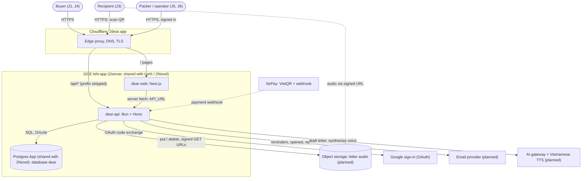

# 2dear — Architecture

System document: what sits **between** the 2dear services. Service internals live
in each service's own document. Status 2026-11-11: both services are starter
skeletons (`web` renders a placeholder home, `api` serves health and the starter
example module); components marked *(planned)* below are MVP decisions, not code.

## Sources

| Need | Read |
| --- | --- |
| Product requirement (IDs `P*`, `C*`, `PD*`, `S*`, `K*`, `O*`, `F*`, `N*`, `D*`, `R*`) | [../../docs/2dear/requirement.md](../../docs/2dear/requirement.md) |
| Approved prototype and UI decisions | [../../docs/2dear/design.md](../../docs/2dear/design.md), [prototype](../../docs/2dear/prototype/) |
| Web internals (modules, data fetching, cacheable pages) | [../web/docs/ARCHITECT-WEB.md](../web/docs/ARCHITECT-WEB.md) |
| Web visuals (2ui theme, tokens) | [../web/DESIGN.md](../web/DESIGN.md) |
| API internals (layers, errors, mounts, database rules) | [../api/docs/ARCHITECTURE-API.md](../api/docs/ARCHITECTURE-API.md) |
| Deploy and release | [../RELEASE.md](../RELEASE.md), `web/2server/deploy.yaml`, `api/2server/deploy.yaml` |
| Next horizon and scaling roadmap | [architecture-next.md](architecture-next.md) |
| Shared Postgres App | [../../platform/postgres.yaml](../../platform/postgres.yaml), [../../platform/README.md](../../platform/README.md) |
| 2server contracts | <https://2found.dev/docs/2server/index.md>, [source config](https://2found.dev/docs/2server/source-config/index.md) |

## Fixed constraints

- **web** — Next.js App Router (16.x), React 19, Tailwind 4, TanStack Query, Zod;
  Node.js + pnpm. UI components from **2ui** (`@tofound/ui`, exact-pinned) with a
  2dear-owned theme; LoHi's `DESIGN.md` palette does not apply.
- **api** — Bun + Hono + Zod. Database access through drizzle-orm once a database
  is added (repo hard constraint).
- **Hosting** — 2server Apps `dear-web` and `dear-api` on the existing GCE VM
  `lohi-app` (`lohi-dev-lohi`, `asia-southeast1-a`), images in
  `asia-southeast1-docker.pkg.dev/lohi-dev-lohi/docker/`. Assumed (2026-11-11,
  same pattern as 2Novel); see D2.
- **Domain** — `2dear.app` behind Cloudflare, owned by the `dear-web` App's domain.
  TODO(2build): confirm the `2dear.app` zone is Active in Cloudflare and covered by the VM's token — founder.
- **Identity** — buyers and staff sign in with **Google** (OAuth, decided
  2026-11-11: no SMS or Zalo OA available, so a phone magic link cannot be
  delivered; this replaces C4's SMS/Zalo link and relaxes C5). The api owns the
  session cookie on `2dear.app`. A recipient never signs in: read code (QR) plus,
  when set, their phone number (O2). Staff (`/kho`, `/ops`) are Google accounts on
  an api-held allowlist.
  TODO(2build): Google OAuth client for 2dear.app (redirect `https://2dear.app/api/auth/google/callback`) — founder creates it in Google Cloud console.
- **Payments** — SePay VietQR (C3); COD optional for bears.
- **Language** — Vietnamese UI; Vietnamese TTS voice (S1).

## Components

Browsers reach one origin, `2dear.app`: pages go to `dear-web`, `/api/*` goes
straight to `dear-api`. Only the api touches the database, audio storage and the
external providers.

| Directory | Role |
| --- | --- |
| `web/` | Public product pages (`/qua/{slug}`, SSR), checkout, Studio, letter page, story image, "Đơn của tôi", staff `/kho` and `/ops` |
| `api/` | Catalog and prices, orders and payments, letters/chapters, read codes and card binding, events, notifications, reminders |
| `docs/` | This document and the next-generation design |

## Boundaries and contracts

- **One origin.** `dear-web`'s 2server domain routes `/api` (stripped) to
  `dear-api`, so browsers call `/api/...` with no CORS. Server components call the
  api through `API_URL` with `apiFetch`; the error envelope is
  `{ error: { code, message, requestId } }` (api document).
- **The api is the only writer** of orders, letters, chapters, read codes, cards,
  events and audio objects. The web holds no database credentials.
- **Audio** never streams through the api: the api uploads/deletes objects and
  hands out short-lived signed URLs only after the read code (+ phone) checks.
  TODO(2build): audio storage bucket, region and lifecycle — first Studio recording ticket.
- **SePay** calls the api webhook; the api verifies the key, settles idempotently
  per transfer and emits `order_paid`. The client never reports a payment.
- **Sign-in.** The browser goes to `/api/auth/google`; the api exchanges the code,
  creates the buyer by Google `sub`, and sets an httpOnly session cookie. Pages read
  the session only in private routes or client islands (invariant 1).
- **Notifications and reminders** (S6, N1, N2) go by email to the buyer's Google
  address; the buyer also sees them in "Đơn của tôi". No SMS or Zalo. Reminders are
  a scheduled job inside the single api replica.
  TODO(2build): transactional email provider and sender domain (e.g. `thu@2dear.app`) — founder; until then notifications are in-app only.
- **AI** (S3 drafts, S1 TTS) are api calls to an AI gateway / TTS provider; the
  browser never holds a provider key.
  TODO(2build): TTS voice provider and the AI gateway to reuse (2server `ai` App or another) — first Studio AI ticket.
- **Events (M1)** are rows written by the api; the web reports client-side events
  (`story_created`, `story_shared`, `visit_from_story`) through the api. No external
  analytics service.

## Invariants

1. Product pages (`/qua/{slug}`, home) render the same bytes for every viewer and
   never read cookies or identity (PD1). Private pages (Studio, letter, order,
   staff) send `noindex, nofollow` and are never cached (R2).
2. Prices and plan contents come from the api; a client renders them and never
   computes or sends back a price (P4).
3. A letter and its audio are readable only with a valid, unrevoked read code, plus
   the recipient's phone when one was set. No endpoint lists letters (R2, O2).
4. `first_opened_at` is written only by a real recipient open: never by preview
   (S4) and never while the letter is unfinished (O5).
5. A chapter is editable until `first_opened_at`; after it, the chapter is
   immutable and new words go into a new chapter (S5).
6. Binding a card fails if the card already belongs to another order (K4); revoking
   a read code invalidates it immediately (K7).
7. Read codes are unguessable (≥ 128 bits of randomness) and wrong attempts are
   rate-limited per IP/device; wrong recipient phones lock temporarily (K6, O2).
8. A bear order set to "deliver when finished" cannot be marked shipped before
   `message_completed` (C2).
9. Deleting a letter deletes its audio objects from storage, not only the rows (R3).
10. Support tools and agents cannot read letter content unless the buyer sends it
    (R4).
11. Letter text reaches a story image only from the recipient's own selection; the
    image is rendered in the browser, defaulting to "hide words" (F2, F5).

## Key decisions

| # | Decision | Reason |
| --- | --- | --- |
| D1 | Two services (`web` Next.js, `api` Hono) from the 2build starters, one origin via the 2server `/api` route | Same split as 2Novel; no CORS or cross-site cookies; each service keeps its starter's rules |
| D2 | Run on the existing `lohi-app` VM through 2server | MVP is an experiment (requirement Q7); no new VM bill. Leaving it is a roadmap stage with a trigger |
| D3 | Database `dear` in the platform Postgres App shared with 2Novel (created 2026-11-11), roles `dear_owner` (no login), `dear_migrator` (migrations only), `dear_app` (DML only); migrated by Drizzle in an api `preDeploy` | Same cluster, backups and role pattern as 2Novel's `translate`; no second cluster to run |
| D4 | Audio in private object storage behind signed URLs | Keeps large bytes off the api and the database; deletion is real (R3) |
| D5 | Buyers sign in with Google; recipients use read code + phone, never an account | No SMS/Zalo channel exists (owner, 2026-11-11); Google is one tap and gives an email address for notifications |
| D6 | Story image rendered client-side | Letter text stays on the device unless chosen (F5); works in in-app browsers without a server renderer |
| D7 | 2ui components with a 2dear-owned theme | Repo rule: reuse 2ui; 2dear is a new brand (design.md) |

## Open risks

- Shared VM: a LoHi/2Novel incident or deploy can take 2dear down during the
  Christmas sale window; one VM is one failure domain.
- Seller identity (2dear vs. Fuwai) for page copy and JSON-LD is undecided (Q8).
- Google sign-in adds a step to the ~30 s checkout (C1) and fails in some in-app
  browsers (Google blocks OAuth in embedded webviews): checkout from Zalo/Facebook
  may need an "open in browser" hand-off. Recipients are unaffected.
- In-app browsers (Zalo, Facebook, TikTok) may block recording, downloads or audio
  autoplay (O1, O4, F4); needs device testing.
